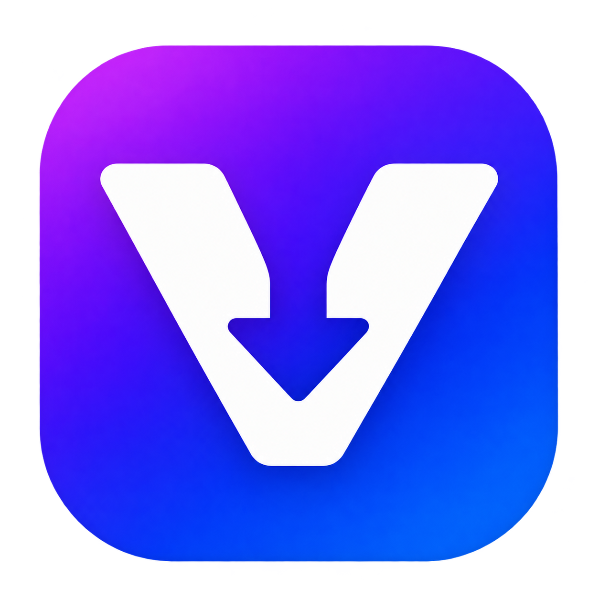

<p align="center"></p>

# VDown

**Video + Download.** Video bağlantılarını önizleyip Mac’e indirmek için Swift/AppKit ve WebKit
kullanan masaüstü uygulaması.

**Sürüm:** 2.1.0 · **Platform:** macOS 14+, Apple Silicon (M serisi).

## İndir ve kur

### [VDown 2.1.0 — DMG indir](https://github.com/wearebrandpeople/VDown/releases/download/v2.1.0/VDown-2.1.0-Apple-Silicon.dmg)

1. DMG dosyasını açın.
2. **VDown** uygulamasını **Applications / Uygulamalar** klasörüne sürükleyin.
3. Uygulamayı Uygulamalar klasöründen açın.

Uygulama Developer ID ile imzalı ve Apple tarafından notarize edilmiştir.
DMG de imzalanmış, notarize edilmiş ve onay bileti pakete eklenmiştir.
Intel Mac’ler bu pakette desteklenmez.

[Tüm sürümler ve sağlama toplamları](https://github.com/wearebrandpeople/VDown/releases)


VDown, önceki Video İndir uygulamasının yeni adı ve görsel kimliğidir. Güncelleme mevcut ayarları ve indirme geçmişini kullanır.

## Özellikler

- Bağlantı önizlemesi, kalite seçimi ve indirme kuyruğu.
- Varsayılan orijinal video, uyumlu çıktı ve ses seçenekleri.
- İndirmeyi duraklatma/devam ettirme ve indirme geçmişi.
- Aktif işleri koruyarak geçmiş temizleme ve yerel kapak önbelleği.

## Proje düzeni

- `app/`: Swift uygulaması, web arayüzü ve üçüncü taraf bildirimleri.
- `tests/`: model ve işlem zaman aşımı testleri.
- `scripts/`: derleme ve isteğe bağlı imzalama/notarizasyon.
- `tools/`: bağımlılıkları mevcut uygulamadan aktarma yardımcısı.

## Derleme

Xcode Command Line Tools, Python 3 ve `tools/README.md` içinde listelenen
çalıştırılabilir bağımlılıklar gereklidir. Mevcut uygulamadan bağımlılıkları aktarın:

```sh
bash tools/from-app.sh '/Applications/VDown.app'
bash scripts/build.sh
open 'outputs/VDown.app'
```

Node için alternatif bir dosya `NODE_BINARY` ortam değişkeniyle belirtilebilir.
Kaynak deposu büyük üçüncü taraf ikili dosyalarını içermez. Bildirimler:
[THIRD-PARTY.txt](app/THIRD-PARTY.txt).

Uygulama simgesi onaylanan `app/assets/VDown.png` dosyasından `scripts/build-icon.sh` ile üretilir.

## Testler

```sh
mkdir -p work/tests
swiftc -swift-version 5 app/Models.swift tests/ModelsTests.swift -o work/tests/models
work/tests/models
swiftc -swift-version 5 app/EngineRun.swift tests/EngineRunTests.swift -o work/tests/engine
work/tests/engine
node --check app/ui/app.js
```

## Dağıtım imzası

Yerel derleme ad-hoc imzalıdır. Developer ID ile dağıtım için kendi sertifikanız
ve Keychain’de yapılandırılmış notarizasyon profiliniz gerekir:

```sh
SIGNING_IDENTITY='Developer ID Application: ...' bash scripts/sign-release.sh
NOTARY_PROFILE='YourProfile' bash scripts/notarize-release.sh
# Apple kabul ettikten sonra:
NOTARY_PROFILE='YourProfile' bash scripts/finalize-notarization.sh
```

Bu depoda sertifika, özel anahtar, parola veya notarizasyon sonucu yoktur.
2.1.0 uygulamasının Apple notarizasyon kaydı Accepted olarak doğrulandı.
Yayımlanan DMG ve içindeki uygulama için stapler, kod imzası ve Gatekeeper kontrolleri geçti.

## Yerel veriler

İndirme geçmişi, kullanıcı ayarları, kapak önbelleği, indirilen videolar ve
geçici çalışma dosyaları kaynak deposuna dahil değildir.
